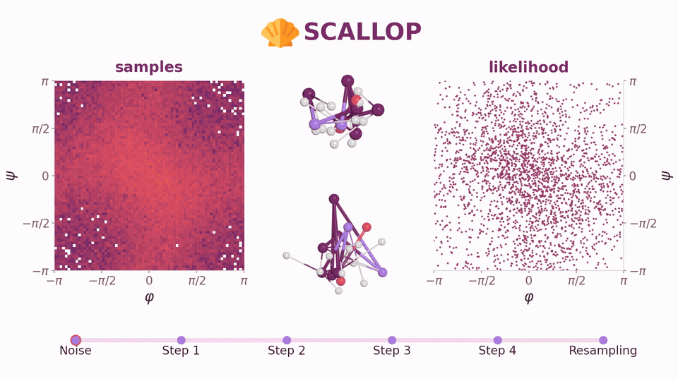

#  SCALLOP

[](#reference)
[](https://arxiv.org/abs/2606.29110)

[**Project page: SCALLOP — Few-Step Boltzmann Generators via Scalable Likelihood Flow Maps**](https://tonyauyeung.github.io/scallop/)

This is the official codebase for [SCALLOP: Few-Step Boltzmann Generators via Scalable Likelihood Flow Maps](https://arxiv.org/pdf/2606.29110) (NeurIPS 2026).
This repository provides a PyTorch implementation of SCALLOP for five peptide systems:
`ace_a_nme`, `aaa`, `ace_aaa_nme`, `aaaaaa`, and `chignolin`:
- [Environment](#environment)
- [Experiments](#experiments)
  - [Pretrain the velocity teacher](#pretrain-the-velocity-teacher)
  - [Likelihood flow maps](#likelihood-flow-maps)
    - [SCALLOP](#scallop-flow-map)
    - [F2D2](#f2d2)
- [Acknowledgments](#acknowledgments)
- [Reference](#reference)

[](assets/scallop.mp4)

<a id="environment"></a>

## Environment 🏝️

```bash
conda env create -f environment.yml
conda activate flowmaps
```

<a id="experiments"></a>

## Experiments 🧪

### Pretrain the velocity teacher

```bash
# <system>: ace_a_nme | aaa | ace_aaa_nme | aaaaaa
python py/launchers/learn.py --cfg_path 'configs.<system>' \
    --mode pretrain_v --from_scratch \
    --ts_data_dir datasets/ts --output_folder '<run-dir>/pretrain_v'
```

### Likelihood flow maps

Use the final velocity checkpoint from the same system to initialize each model
and provide its teacher. Evaluation uses the corresponding final density checkpoint.
The `v1` evaluation recipe generates 1M proposals, evaluates 10k samples per stage,
and runs 1,024 MALA updates, reporting validation and test metrics separately.

<a id="scallop-flow-map"></a>

####  SCALLOP

Training 👇

```bash
# <system>: ace_a_nme | aaa | ace_aaa_nme | aaaaaa
python py/launchers/learn.py --cfg_path 'configs.<system>' \
    --mode dlogpdt \
    --ts_data_dir datasets/ts --output_folder '<run-dir>/dlogpdt' \
    --network_load_path '<velocity-checkpoint.pt>' --teacher_load_path '<velocity-checkpoint.pt>'
```

Evaluation 👇

```bash
# <system>: ace_a_nme | aaa | ace_aaa_nme | aaaaaa
python py/launchers/eval_peptide_ts.py --cfg_path 'configs.<system>' \
    --mode dlogpdt --eval_recipe v1 \
    --ts_data_dir datasets/ts --out_dir '<run-dir>/eval/dlogpdt' \
    --ckpt_path '<dlogpdt-checkpoint.pt>' --batch_size 2000 --n_workers 8
```

#### F2D2

Training 👇

```bash
# <system>: ace_a_nme | aaa | ace_aaa_nme | aaaaaa
python py/launchers/learn.py --cfg_path 'configs.<system>' \
    --mode hutchinson \
    --ts_data_dir datasets/ts --output_folder '<run-dir>/hutchinson' \
    --network_load_path '<velocity-checkpoint.pt>' --teacher_load_path '<velocity-checkpoint.pt>'
```

Evaluation 👇

```bash
# <system>: ace_a_nme | aaa | ace_aaa_nme | aaaaaa
python py/launchers/eval_peptide_ts.py --cfg_path 'configs.<system>' \
    --mode hutchinson --eval_recipe v1 \
    --ts_data_dir datasets/ts --out_dir '<run-dir>/eval/hutchinson' \
    --ckpt_path '<hutchinson-checkpoint.pt>' --batch_size 2000 --n_workers 8
```

### Image experiments

Code and experiments for images are in [scallop-image](https://github.com/tonyauyeung/scallop-image.git).

## Acknowledgments ⚽️

This codebase builds on [JAX-F2D2](https://github.com/Keely-Ai/JAX-F2D2)
and uses [Transferable Samplers](https://github.com/transferable-samplers/transferable-samplers)
for peptide data, preprocessing, and evaluation. We thank the authors for making
their code and data publicly available.

## Reference 🐨

📧 For questions, contact [ro352@cam.ac.uk](mailto:ro352@cam.ac.uk).

```bibtex
@inproceedings{ouyang2026fewstep,
  title = {Few-Step Boltzmann Generators via Scalable Likelihood Flow Maps},
  author = {OuYang, RuiKang and Yu, Hanlin and Ai, Xinyue and He, Yutong and Boffi, Nicholas Matthew and Ravikumar, Pradeep and Hern{\'a}ndez-Lobato, Jos{\'e} Miguel and Simchowitz, Max and Miller, Benjamin Kurt and Chehab, Omar},
  booktitle = {Advances in Neural Information Processing Systems (NeurIPS)},
  year = {2026},
  url = {https://openreview.net/forum?id=mfdTHHRIid},
  note = {Also accepted at SPIGM@ICML.},
}
```
